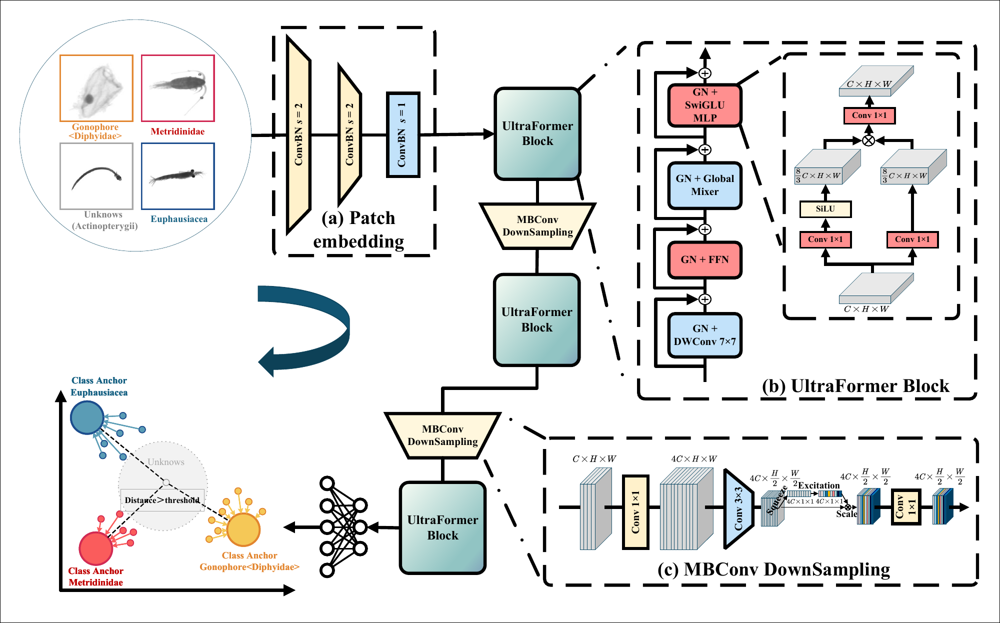

# PlanktonNet

Implementation of **PlanktonNet: A Three-Stage Hybrid Backbone for Fine-Grained Plankton Recognition**. The model combines a three-stage backbone, UltraFormer blocks, and MBConv downsampling. [Paper](https://doi.org/10.1016/j.eswa.2026.135015)



*Model overview from Fig. 3 of the paper.*

## Install

Use Python 3.11 and a virtual environment. Install the dependencies from the repository root.

```sh
python -m pip install -r requirements.txt
```

For a CPU-only installation, install the matching PyTorch and TorchVision CPU wheels before installing the remaining requirements.

```sh
python -m pip install torch==2.7.1 torchvision==0.22.1 --index-url https://download.pytorch.org/whl/cpu
```

## Data

| Benchmark | Classes | Link | Folder used in the commands |
|---|---:|---|---|
| ZooplanktonBench50 | 50 | [Google Drive](https://drive.google.com/file/d/1okK2YFM7SoFCH6xRhrk4bdoeOGrLhJHL/view?usp=drive_link) | `data/ZooplanktonBench50` |
| ZooplanktonBench50 (Open-Set) | 50 known + unknown | [Google Drive](https://drive.google.com/file/d/1jh3kuf76sJyK6zzeuk1h5_dYrec9I67K/view?usp=sharing) | `data/ZooplanktonBench50_OpenSet` |
| ZooCAMNet76 | 76 | [Google Drive](https://drive.google.com/file/d/1ZZQJA4oDsdVHSqH81Sg6IJvZ0s-iqtt_/view?usp=sharing) | `data/ZooCAMNet76` |
| ZooScanNet101 | 101 | [Google Drive](https://drive.google.com/file/d/1s3qmZB9b_SUTyQhtZXNNY6O4UCXpqKgH/view?usp=drive_link) | `data/ZooScanNet101` |

Extract the open-set and ZooCAMNet76 archives at the repository root. For the other two archives, put the extracted benchmark under the folder name in the table. Keep the split folders and class subfolders inside each benchmark. For HZWPlankton8, contact the corresponding authors listed in the paper.

## Closed-set classification

`closed_set_backbone.py` contains the PlanktonNet classifier used by the closed-set training, validation, and Jetson scripts. Set `--num-classes` to the class count of the selected benchmark.

```sh
python train.py --data-dir data/ZooplanktonBench50 --model PlanktonNet --num-classes 50 --batch-size 26 --workers 0 --epochs 300 --opt adamw --lr 1e-4 --warmup-epochs 10 --warmup-lr 1e-5 --clip-grad 0.5 --weight-decay 0.2 --cooldown-epochs 5 --train-interpolation bicubic --mixup 0.4 --cutmix 0.6 --aa rand-m9-mstd0.5-inc1 --img-size 224 --device cuda:0
```

Use a checkpoint from your training run for validation. Replace the example checkpoint path with the file produced by training.

```sh
python validate_github.py --data-dir data/ZooplanktonBench50 --split test --model PlanktonNet --checkpoint path/to/closed-set-checkpoint.pth.tar --num-classes 50 --batch-size 32 --workers 0 --device cpu --metrics-avg macro
```

## Open-set recognition with CAC

`PlanktonNet.py` supplies the backbone features for open-set recognition. CAC training uses cross-entropy on the class projection and a squared Euclidean penalty to the fixed class anchors. Evaluation recomputes the class centers from training features, scores each sample by its distance to the nearest center, and selects the rejection threshold on the validation splits.

```sh
python train_cac.py --data-dir data --dataset ZooplanktonBench50_OpenSet --workers 0 --device cuda:0
python run_open_set.py --case cac_planktonnet --data-root data/ZooplanktonBench50_OpenSet --checkpoint path/to/cac-checkpoint.pth.tar --batch-size 32 --device cpu
```

Use the checkpoint produced by the CAC training command for the second command. The runner also offers evaluation entry points for EfficientNetV2-S, OpenMax, PMAL, and IsPlanktonIR. Each configuration requires a matching checkpoint. The default output directory is `results/new_run/paper/`.

## Jetson Orin NX

Install the PyTorch and TorchVision builds for your JetPack version, then install the benchmark dependencies. Supply a matching closed-set checkpoint.

```sh
python -m pip install -r requirements-jetson.txt
python benchmark_jetson.py --model PlanktonNet --checkpoint path/to/closed-set-checkpoint.pth.tar --num-classes 50 --data-dir data/ZooplanktonBench50/test --workers 0 --batch-sizes 1 8 16 32 64 --output jetson.csv
```

## Citation

If you use the code, cite the paper using [the article DOI](https://doi.org/10.1016/j.eswa.2026.135015). See [CITATION.cff](CITATION.cff) and [the code license](LICENSE).
